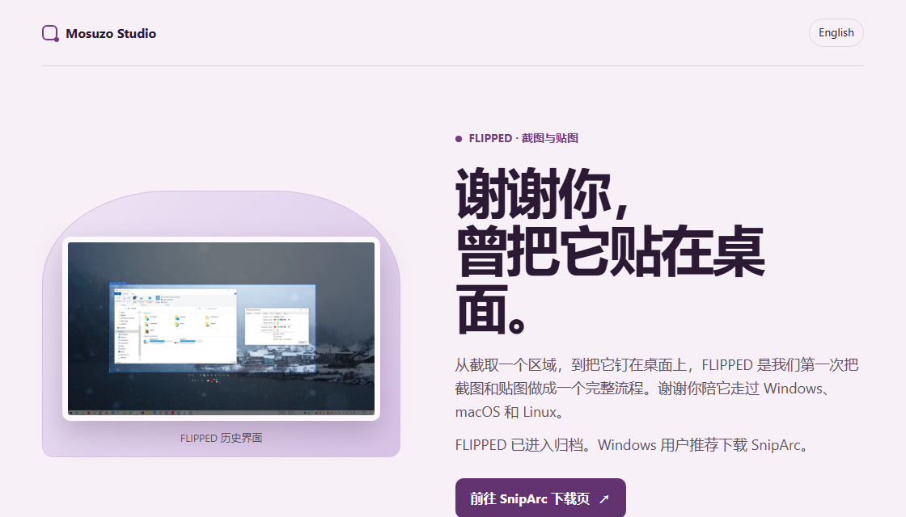

# FLIPPED Pages

**Legacy FLIPPED website pages and the historical release index.**

[简体中文](README.zh_CN.md) · **English**

> **This repository is archived.** FLIPPED is a screenshot and pinning tool for Windows, macOS and Linux. Its website and project repository have since moved to [SunnyCapturer/FLIPPED](https://github.com/SunnyCapturer/FLIPPED) — visit <https://flipped.xmuli.tech/> for the current pages.

## What this repository keeps

- **The old FLIPPED website** — the Jekyll pages under [`docs/`](docs) that were published on GitHub Pages, including the per-platform snapshots (Windows 10, macOS 13, Ubuntu 20.04), the feature overview and the keyboard shortcut reference.
- **The historical release index** — the downloads for the v1.1.0-beta to v1.3.1 line, kept as tags on this repository:

| Release | Date | Notes |
| --- | --- | --- |
| [v1.1.0-beta](https://github.com/SunnyCapturer/FlippedPages/releases/tag/v1.1.0) | 2023-04-08 | First public beta; Windows, Debian and macOS builds |
| [v1.2.3-beta](https://github.com/SunnyCapturer/FlippedPages/releases/tag/v1.2.3) | 2023-04-23 | Windows and Debian builds, x64 and arm64 |
| [v1.3.0](https://github.com/SunnyCapturer/FlippedPages/releases/tag/v1.3.0) | 2023-08-13 | First official release; portable and installer builds |
| [v1.3.1](https://github.com/SunnyCapturer/FlippedPages/releases/tag/v1.3.1) | 2023-08-22 | Last FLIPPED release; Windows x64 and x86 |

The published copy of `docs/` now serves a short notice that points to the current site; the earlier pages remain in the Git history of this repository.

## What FLIPPED was

A cross-platform Qt/C++ screenshot tool with desktop pinning: multi-screen and delayed capture, intelligent window detection (Windows and Linux), rectangle / ellipse / arrow / freehand / mosaic / text / serial-number annotation, multi-level undo and redo, three capture-frame styles with custom accent colours, a plugin framework and an offline-only design with no network features.

## Where to find FLIPPED now

| | |
| --- | --- |
| Website | <https://flipped.xmuli.tech/> |
| Website and code | <https://github.com/SunnyCapturer/FLIPPED> |
| Successor (SnipArc) | <https://sniparc.mosuzo.com/download> |
| Screenshot tool archive | <https://screenshot-archive.xmuli.tech/> |

## License

The pages and the release assets in this repository are covered by the terms in [LICENSE](LICENSE).

---

FLIPPED is part of the [SunnyCapturer](https://github.com/SunnyCapturer) series by [XMuli](https://github.com/XMuli).
