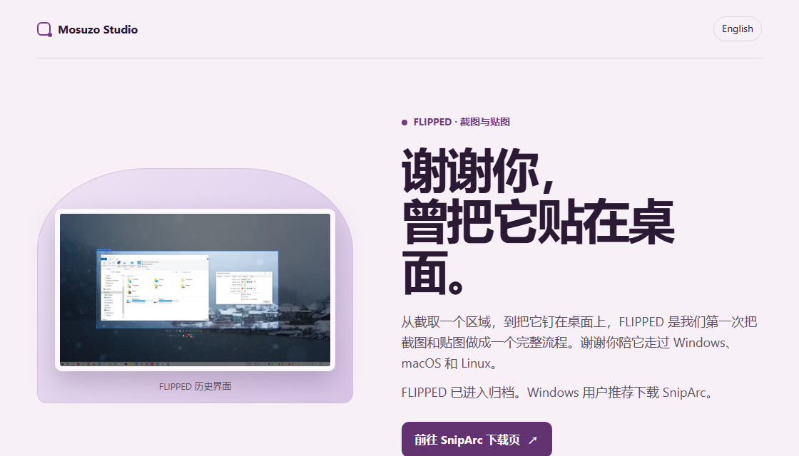

# FLIPPED Pages

**FLIPPED 旧版官网页面与历史发布索引。**

**简体中文** · [English](README.md)

> **本仓库已归档。** FLIPPED 是一款面向 Windows、macOS 与 Linux 的截图与贴图工具。其官网与项目仓库现已迁至 [SunnyCapturer/FLIPPED](https://github.com/SunnyCapturer/FLIPPED)，当前页面请访问 <https://flipped.xmuli.tech/zh-cn/>。

## 本仓库保留的内容

- **FLIPPED 旧版官网** — [`docs/`](docs) 下曾发布在 GitHub Pages 的 Jekyll 页面，包含各平台截图（Windows 10、macOS 13、Ubuntu 20.04）、功能总览与快捷键说明。
- **历史发布索引** — v1.1.0-beta 到 v1.3.1 的下载，以标签形式保存在本仓库：

| 版本 | 日期 | 说明 |
| --- | --- | --- |
| [v1.1.0-beta](https://github.com/SunnyCapturer/FlippedPages/releases/tag/v1.1.0) | 2023-04-08 | 首个公开测试版；提供 Windows、Debian 与 macOS 构建 |
| [v1.2.3-beta](https://github.com/SunnyCapturer/FlippedPages/releases/tag/v1.2.3) | 2023-04-23 | Windows 与 Debian 构建，含 x64 与 arm64 |
| [v1.3.0](https://github.com/SunnyCapturer/FlippedPages/releases/tag/v1.3.0) | 2023-08-13 | 首个正式版；提供便携版与安装版 |
| [v1.3.1](https://github.com/SunnyCapturer/FlippedPages/releases/tag/v1.3.1) | 2023-08-22 | 最后一个版本；Windows x64 与 x86 |

`docs/` 的线上副本现在只显示一行迁站提示，更早的页面仍保留在本仓库的 Git 历史中。

## FLIPPED 是什么

一款跨平台的 Qt/C++ 截图工具，支持贴图置顶：多屏截图与延时截图、智能识别窗口（Windows 与 Linux）、矩形、椭圆、箭头、自由画笔、马赛克、文字、序号标注，多级撤销与重做，三套截图框样式与自定义主题色，带插件框架，完全离线、不含任何联网功能。

## 现在去哪里找 FLIPPED

| | |
| --- | --- |
| 官网 | <https://flipped.xmuli.tech/zh-cn/> |
| 官网与代码 | <https://github.com/SunnyCapturer/FLIPPED> |
| 后续作品 SnipArc | <https://sniparc.mosuzo.com/zh-cn/download> |
| 截图工具档案 | <https://screenshot-archive.xmuli.tech/> |

## 许可证

本仓库中的页面与发布产物适用 [LICENSE](LICENSE) 中的条款。

---

FLIPPED 是 [XMuli](https://github.com/XMuli) 的 [SunnyCapturer](https://github.com/SunnyCapturer) 系列作品之一。
